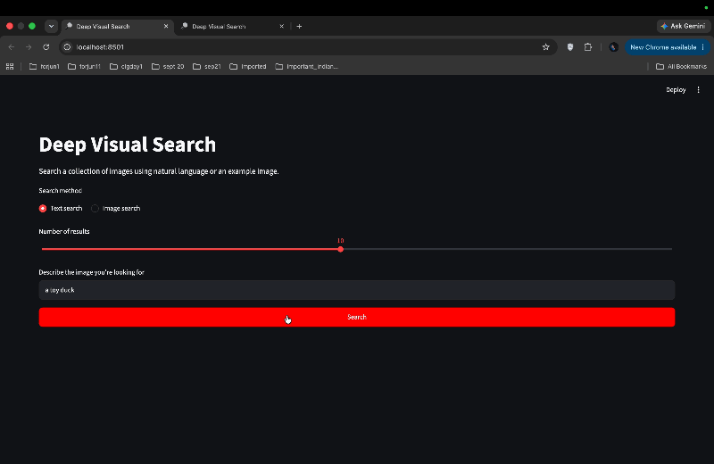
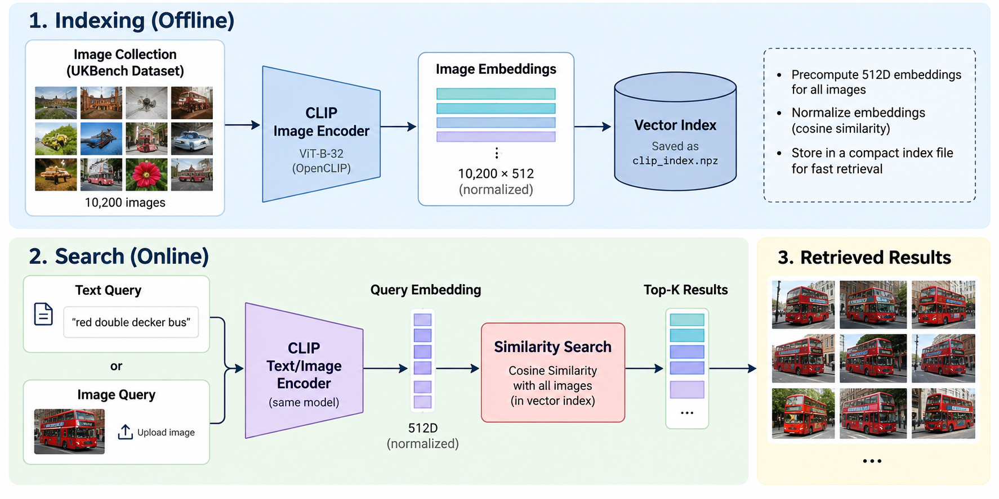

# Deep Visual Search

**Image-to-image and text-to-image retrieval powered by CLIP.**

Search a collection of 10,200 images using natural-language descriptions or a reference image. Built with OpenCLIP, PyTorch, FastAPI, and Streamlit.

<p align="center">
  
</p>

<p align="center">
  <b>10,200 images</b> · <b>2,550 evaluation queries</b> · <b>94.99% mean N-S score</b>
</p>

## Features

- **Text-to-image search:** Find images using natural-language queries.
- **Image-to-image search:** Retrieve visually similar images from a reference image.
- **Semantic embeddings:** Use CLIP's shared image-text embedding space.
- **REST API:** Serve retrieval through FastAPI with configurable result counts.
- **Web interface:** Explore results through Streamlit.

## How It Works

<p align="center">
  
</p>

1. **Indexing:** Encode the image collection into normalized 512-dimensional CLIP embeddings.
2. **Query encoding:** Convert text queries or uploaded images into the same embedding space.
3. **Retrieval:** Rank images by cosine similarity and return the top results.

Embeddings are precomputed, so searches do not require re-encoding the entire collection.

## Results

Evaluated on the UKBench dataset using 2,550 queries.

| Metric | Result |
|---|---:|
| Mean N-S score | 3.7996 / 4 |
| Mean N-S percentage | 94.99% |
| Recall@4 | 94.84% |
| Recall@10 | 97.44% |
| Mean Reciprocal Rank | 0.9875 |
| Failed queries | 0 |

*Results are from the recorded evaluation run. See `src/evaluate.py` for the evaluation implementation.*

## Tech Stack

`Python` · `PyTorch` · `OpenCLIP` · `CLIP` · `NumPy` · `FastAPI` · `Streamlit`

## Getting Started

### 1. Install dependencies

```bash
python -m venv .venv
source .venv/bin/activate
pip install -r requirements.txt
```

### 2. Prepare the image index

Download or place the UKBench dataset locally, configure its path as required by the indexing script, and generate the embeddings:

```bash
python src/build_index.py
```

The dataset and generated index are not included in this repository. Indexing downloads the required model weights if they are not already cached.

### 3. Launch the application

Start the API:

```bash
uvicorn api.main:app --reload
```

In another terminal, launch the web interface:

```bash
streamlit run app/streamlit_app.py
```

API documentation is available at `http://127.0.0.1:8000/docs`.

## API Endpoints

| Method | Endpoint | Purpose |
|---|---|---|
| `GET` | `/health` | Health check |
| `POST` | `/search/text` | Search using text |
| `POST` | `/search/image` | Search using an image |

## Project Structure

```text
├── app/
│   └── streamlit_app.py
├── api/
│   └── main.py
├── src/
│   ├── build_index.py
│   ├── search.py
│   └── evaluate.py
├── data/
│   └── index/          # Generated locally
├── assets/             # README visuals
├── tests/
├── requirements.txt
└── README.md
```

## Limitations

- Search is limited to the indexed image collection.
- The dataset, generated embeddings, and model weights are not bundled with the repository.
- The current setup is intended as a local demo; production deployment requires appropriate model hosting, storage, and resource planning.

## Demo

[Watch the full demo](assets/demo.mp4)
